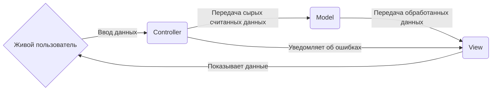
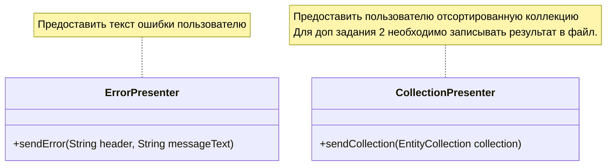
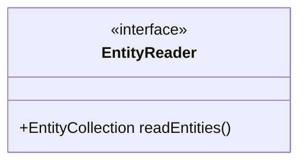
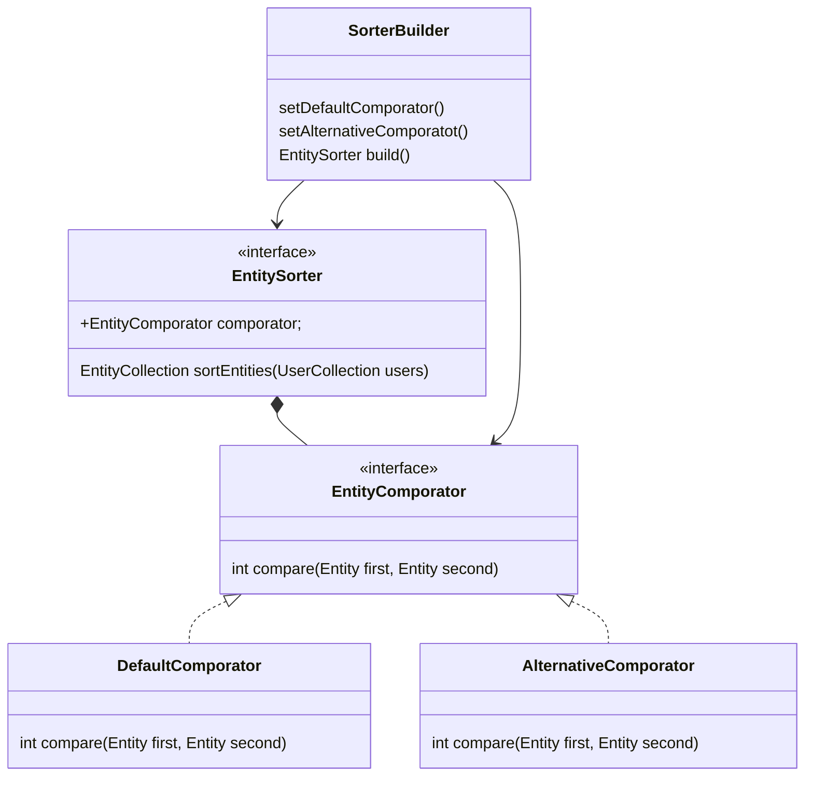
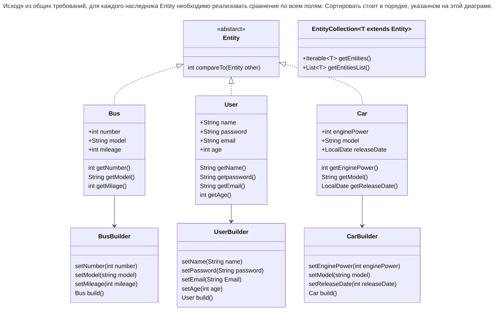
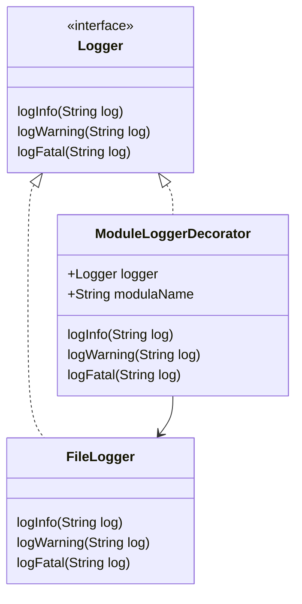

# FirstTeamProject

# Общие конвенции
- Реализация каждого модуля пишется в отдельной папке проекта.
- Реализация каждого подмодуля, если такие появляются при необходимости, пишется в отдельной папке модуля.
- Абстракции пишутся в отдельной папке __abstractions__
- В этом документе описываются API модулей, не их реализация.
- Помним, что один класс может реализовать несколько интерфейсов. Так же помним про остальные принципы SOLID.
- Помним так же и про принцип Dependency Invertion.
- Каждый функциональный блок должен осуществлять логирование через соответствующий интерфейс. 

Если возникает необходимость в "затычке" абстракции, которая на данный момент не реализована, в гитигнор добавлена папка `/project/src/main/java/test/`. Для прочих файлов `/project/test/`. 

# Архитектура

Более уместным и простым будет использовать архитектуру Model View Controller.
На пальцах:
- Controller считывает и заставляет считать Model
- Model считает и заставляет показывать View
- View показывает

Соответственно мы имеем вот такую цепочку зависимостей:


В ТЗ не уточнено, обязательно-ли использовать консоль или можно использовать UI фреймворк. 

Если UI фреймворк использоваться не будет, то View будут отвечать за форматированное красивое отображение данных в консоли и запись в файлы. Controller сооветственно за цикличный ввод данных и соответственно завершение программы.

Если решимся использовать UI фреймворк, то надо будет его адаптировать под архитектуру.


## View
> В данном модуле осуществляется отображение информации пользователю. 

__Точкой входа данного модуля являются интерфейсы ErrorPresenter и CollectionPresenter.
Точки выхода у интерфейса нет.__

Представление может меняться в зависимости от полученных данных.

Данный модуль должен иметь 2 интерфейса:
  


## Controller
> В данном модуле осуществляется ввод и валидация данных. 
Будь то ввод с клавиатуры, чтение файла и т.д.
Данный модуль отвечает за целостность данных, которые попадают в модель.

Данный модуль должен иметь реализации интерфейсов:


## Model
> В данном модуле осуществляется взаимодействие с данными.
Основная логика, которая должна выполняться эффективно.

__Эндпоинты данного модуля:__
- класс SorterBuilder
- класс EntitySorter

__Инициализация наследника EntitySorter должна проводиться только через билдер.__
Билдер необходим, так как алгоритм сортировки должен быть один, а способов сравнения 2.
Задача билдера - подставить нужный EntityComporator в EntitySorter.

По окончанию сортировки

Классы модуля:


## Shared
> В этом модуле представлены объекты, использующиеся повсеместно во всех модулях.

### Entities
> В этом подмодуле представлены сущности приложения.

Экземпляры Entity должны быть инициализированы исключительно через соответствующий Builder.
Абстрактный класс Entity должен реализовать Comparable\<Entity>. В нем сравнивается название типа.
Каждый наследник Entity должен переопределить реализацию Comparable\<Entity>. В нем вызвать базовую реализацию метода compareTo, в случае если она вернула 0, произвести сравнение по всем полям.

Этот модуль должен содержать классы:


### Logging
> Этот подмодуль отвечает за логирование приложения.

__Каждый модуль с помощью DI будет получать соответствующий ModuleLoggerDecorator__
Задача декоратора - добавить к логу, которую он получает от модуля, название модуля.

Эта спорная часть архитектуры. Требуется обсуждение с исполнителем.

Классы подмодуля:

Каждый лог должен быть в следующем формате:
`[Уровень серьезности][Модуль] Сообщение`
Например:
```
[Info][Model] Сортировка выполнена
[Fatal][View] Выброшено необработаное исключение
[Warning][Controller] Данные введены неправильно
```

## Tests
> В данном модуле будет содержаться покрытие кода тестами.

К этому модулю будем приступать в последнюю очередь. В первую очередь нужно будет покрыть тестами сортировку. Ну и возможно валидацию контроллера.
